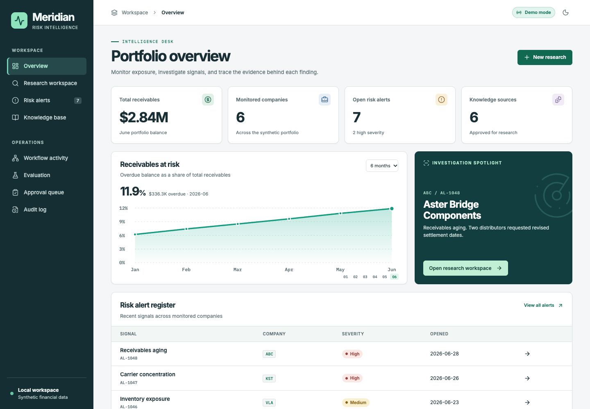
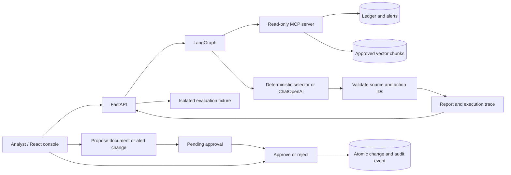
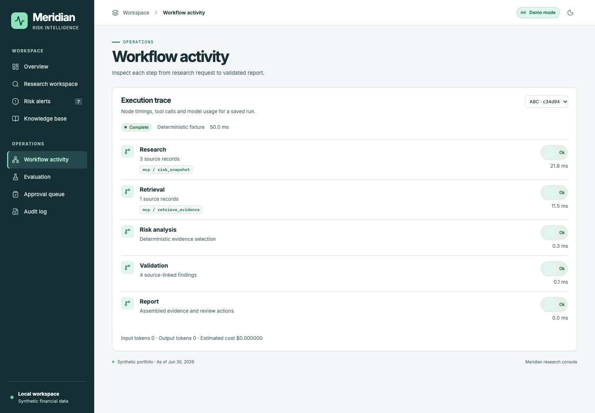

# Enterprise AI Research & Risk Intelligence Agent

**Meridian** is a local analyst console for investigating changes in a synthetic credit portfolio. In the June fixture, ABC’s overdue receivables rise from **$139,742 to $161,455**. An analyst can trace those amounts to the ledger, inspect a credit memo about two distributors, and request a review with a recorded human decision.

This independent portfolio project uses six fictional companies, 72 transaction records, seven risk alerts and six seeded documents. All amounts and observations are synthetic. Demo mode runs the actual graph, SQL queries, document search, approval transactions and evaluation suite without API credentials.



## Run locally

From the repository root on macOS or Linux, with Python 3.12+ and Node 22.12+ or 24 installed:

```sh
python3.12 -m venv .venv
.venv/bin/python -m pip install -r tests/requirements.txt
npm ci --prefix frontend
npm run build --prefix frontend
.venv/bin/python -m backend.risk.bootstrap
.venv/bin/uvicorn backend.risk.main:app --host 127.0.0.1 --port 8000 --no-access-log
```

Open **http://127.0.0.1:8000**. Choose **New research → Run and save research**, then click a source ID in the report. **Workflow activity** shows the two actual tool calls. To test a change, submit `data/sample_upload.csv` in **Knowledge base**, approve it in **Approval queue**, and inspect the entry in **Audit log**. Use **Evaluation → Run evaluation** to calculate results in a clean fixture database.

Local setup uses SQLite and the same embedding function as PostgreSQL. Data persists in `.runtime/meridian.db`. The bootstrap command applies Alembic migrations and seeds missing fixture rows. Running it again preserves reviewed alerts, uploaded documents and reports. To work on the UI, keep the API running in one terminal and use `npm --prefix frontend run dev` in another.

## Deploy the local PostgreSQL stack

Docker Compose builds the frontend, serves its compiled assets from FastAPI, applies migrations and starts PostgreSQL with pgvector. Only the console has a published port, bound to loopback. The database lives in a named volume. For a first run in a fresh checkout:

```sh
cp -n .env.example .env
python3 -c 'from pathlib import Path; import secrets; p=Path(".env"); p.write_text(p.read_text().replace("POSTGRES_PASSWORD=\n", "POSTGRES_PASSWORD="+secrets.token_hex(24)+"\n", 1))'
docker compose up --build --wait
```

The command fills the empty password in the ignored local `.env` file. Keep it for subsequent runs against the volume. Use a hexadecimal password with the supplied connection URL. Open the same local address. Use `docker compose down` to stop the services and retain data. The image runs the app as an unprivileged user. Cloud hosting and shared-user authentication require a separate deployment design.

## Architecture



| Layer | Implementation |
| --- | --- |
| Analyst console | React, TypeScript, Vite, Tailwind CSS, self-hosted fonts, local dark mode. Eight views cover overview, research, alerts, documents, traces, evaluations, approvals and audit. |
| Service and persistence | Python, FastAPI, Pydantic, SQLAlchemy Core, Alembic. SQLite for quick setup, PostgreSQL and pgvector in Compose. |
| Agent | LangGraph controls five ordered nodes. LangChain’s OpenAI adapter supports an explicitly selected live model. The default selector uses deterministic question–evidence token overlap. |
| Retrieval | Company filter, normalized 384-dimensional token-hash vectors, cosine ranking and a three-chunk limit. PostgreSQL runs the distance operator. The small SQLite fixture uses a local dot product. |
| Delivery and checks | Docker multistage build, Compose, GitHub Actions, pytest, Playwright, Ruff, mypy, ESLint, Prettier and TypeScript. |

## Follow a research run

1. **Research** invokes `risk_snapshot` with the selected company. Fixed SQL groups monthly records, compares the last two periods and reads open alerts.
2. **Retrieval** invokes `retrieve_evidence`. Only approved passages for that company enter the candidate pool. A general company overview uses a fixed credit-review vocabulary, while specific questions use their own terms.
3. **Risk analysis** selects evidence IDs and follow-up categories. Live mode uses a structured schema and a model with no callable tools. In demo mode the report is visibly labeled **Simulated response**.
4. **Validation** removes unknown references, reconstructs findings from cited source text, and limits actions to a small review vocabulary. Empty retrieval and provider/tool failures are recorded on the run.
5. **Report** assembles a period summary, open risk factors, findings, source snapshots, confidence, limitations, proposed follow-ups and measured timings. A human's save request commits the report and audit event together.

The MCP SDK client negotiates an in-memory session and calls the same registered tools available through the standalone stdio server. To launch that server for a trusted local client, use `.venv/bin/python -m backend.risk.tools` from the repository root after bootstrap. Both tools enter a database read-only scope.



## API examples

```sh
curl -fsS http://127.0.0.1:8000/api/overview

curl -fsS http://127.0.0.1:8000/api/reports \
  -H 'Content-Type: application/json' -H 'X-Meridian-Action: analyst' \
  -d '{"company":"ABC","question":"Analyze Company ABC, summarize key changes, identify risk signals, and recommend follow-up actions.","confirm":true}'

curl -fsS http://127.0.0.1:8000/api/documents \
  -H 'X-Meridian-Action: analyst' -F 'company=ABC' -F 'confirm=true' \
  -F 'file=@data/sample_upload.csv'

curl -fsS http://127.0.0.1:8000/api/approvals
```

Use the returned proposal ID in `POST /api/approvals/{id}` with the same JSON headers and body `{"decision":"approve","confirm":true}` or `{"decision":"reject","confirm":true}`. Repeating the same decision returns the original outcome. A conflicting decision returns 409. `GET /openapi.json` contains the full typed contract.

## Evaluation and observability

The answer key in [data/evaluation.json](data/evaluation.json) labels seven questions, including a company with no document. Each evaluation starts a temporary seeded SQLite database and executes the actual graph in demo mode. This keeps uploaded data and previous decisions out of the benchmark. Reproduce the raw measurements with:

```sh
.venv/bin/python -m backend.risk.evaluation > .runtime/evaluation.json
```

| Metric | Recorded result | Definition |
| --- | ---: | --- |
| Finding recall | 100% | Mean fraction of labeled evidence IDs present among each case’s validated findings. |
| Exact source support | 100% | Mean proportion of finding texts equal to their cited source text. |
| Document retrieval accuracy | 7/7 | Expected document appeared in the top three, or no document was returned for the empty case. |
| Graph latency | 19.28 ms median / 36.29 ms P95 | Wall-clock duration per case. P95 uses nearest rank. |
| Provider usage | 0 tokens / $0.00 | The deterministic selector makes no provider request. |

The [recorded run](docs/evaluation-baseline.json) includes every question, retrieved and cited IDs, matched counts and timings. Seven fixed cases give regression coverage. They do not estimate live-model accuracy, analyst time saved, or real-world risk prediction. Extractive rendering makes exact support a structural check. The independent [RAGAS cross-check](docs/ragas-baseline.json) measured **100% context recall and 66.7% context precision** across cases. The agent retrieved every labeled source and also returned extra records.

For the optional RAGAS cross-check, install its evaluation dependencies in a separate environment. It compares the retrieved IDs to the independent labels using ID-based context precision and recall, with telemetry disabled and no model calls.

```sh
python3.12 -m venv .runtime/ragas
.runtime/ragas/bin/pip install -r tests/ragas-requirements.txt
.runtime/ragas/bin/python tests/ragas_check.py .runtime/evaluation.json
```

The console shows per-node latency, tool status, model and token counts. `X-Request-ID` correlates normal API responses with structured request logs and committed audit events. A failed live call records unknown usage. With live usage available, the app estimates cost from configured input, cached-input and output rates per million tokens. Missing rates for consumed tokens yield an unknown cost.

## Live model configuration

Copy `.env.example` to `.env`, set `AGENT_MODE=live`, `OPENAI_MODEL` and `OPENAI_API_KEY`, and restart the service. Pick an accessible model supporting strict JSON Schema. Set the three optional USD rates from your applicable pricing if cost tracking is needed. Live research sends the question and selected synthetic source text to the provider. Evaluations always use deterministic mode. Model timeout, bounded output and disabled retries limit each attempt. The adapter's contract and usage parsing are exercised against a mocked HTTP transport. [OpenAI structured outputs](https://developers.openai.com/api/docs/guides/structured-outputs)

## Security review and trade-offs

- **Access.** Loopback binding, trusted hosts, origin checks and a custom mutation header protect the single-user desktop boundary. The header is a browser request guard. A local process with access can act as the analyst. Anyone with database access can alter this audit log. Public ingress requires identity, per-company authorization and protected audit storage.
- **Changes.** The graph has two read tools. Storage mutations require explicit user actions. Uploads stage extracted text; only approval indexes it. The application atomically persists decisions, effects and audit events. A unique digest per company guards against duplicate documents. Report/evaluation creation and staging are explicit save operations.
- **Untrusted material.** Both upload formats have file, text and parsing limits. A disposable parser process has a deadline and CPU limits, plus a Linux memory cap. Common instruction overrides are rejected. Unknown model references cannot create SQL, select another company's data or authorize a change. Text screening cannot establish a document’s truth or catch every instruction.
- **Scale and quality.** Hashing is reproducible offline and inexpensive. Synonyms, contradictions, stale sources and ambiguous intent need a richer corpus and human adjudication. A production pilot would benchmark learned embeddings and hybrid search against labeled analyst queries, add OCR with isolation, separate database roles, and introduce durable jobs before increasing concurrency.
- **Deployment limits.** The local PostgreSQL integration used PostgreSQL 16.2 and pgvector 0.6.2. Compose targets PostgreSQL 17. The Docker engine was unavailable on the development host. The CI definition tests Compose on Linux; an actual hosted Actions run and paid provider integration remain unverified.

## Verification and project map

From the root after local setup:

```sh
.venv/bin/ruff check backend tests
.venv/bin/ruff format --check backend tests
.venv/bin/mypy backend
.venv/bin/pytest -q
cd frontend
npm run lint
npx prettier --check src e2e
npm run typecheck
npm run build
npx playwright install chromium
npm run smoke
```

The browser suite launches an isolated app and temporary SQLite database on port 8174. Use `CHROME_PATH` for an installed Chrome executable. Set `CAPTURE_SHOTS=1` to regenerate the two genuine screenshots. To run the PostgreSQL test, supply `TEST_POSTGRES_URL` pointing to a **dedicated disposable** PostgreSQL database with pgvector installed and an account able to create the extension. The test migrates and seeds that database.

| Location | Contents |
| --- | --- |
| `backend/risk/` | Typed contracts, routes, MCP server, graph, source indexing, change control and evaluation |
| `backend/migrations/` | Versioned database schema |
| `frontend/` | Analyst console and browser smoke tests |
| `tests/`, `data/` | Unit/integration checks, synthetic portfolio, example upload and independently specified labels |
| `infrastructure/`, `compose.yaml`, `.github/workflows/` | Container build, local deployment and CI |
| `docs/` | [Three-minute demo](docs/DEMO_SCRIPT.md), [interview walkthrough](docs/INTERVIEW_WALKTHROUGH.md), [milestones](docs/PLAN.md), [verification record](docs/PROGRESS.md) |
